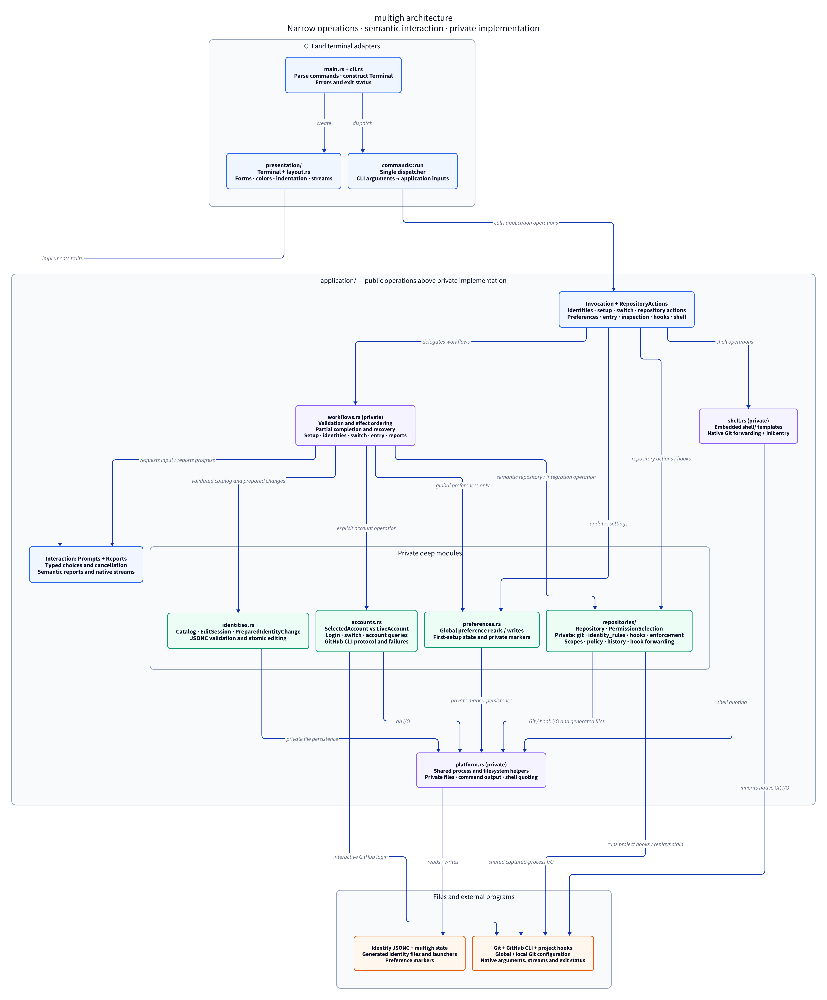

# Development

Build with `cargo build --release`; the executable is `target/release/mgh`.

## Architecture



## Layout

- `src/cli.rs` defines arguments and help; `src/commands/` dispatches commands.
- `src/application/` owns validated identities, workflows, GitHub authentication, repository permissions, Git operations and hooks.
- `src/presentation/` owns forms, colors, indentation and report spacing.
- `shell/` contains the embedded Fish, Bash and Zsh integration.
- `tests/acceptance.rs` registers the behavior groups in `tests/cases/`. `tests/support/` supplies the isolated sandbox, simulated GitHub responses and terminal driver; `tests/fixtures/` contains sample identity data.

## Checks

Tests require Unix, Git 2.45+, Fish, Bash, Zsh, Python 3 and Cocogitto 7+ (`cog`) on PATH. Each test uses temporary home/config/state directories and simulated GitHub authentication, leaving real credentials and repositories untouched.

```sh
cargo fmt --check
cargo test --all-targets
cargo clippy --all-targets -- -D warnings

# Run one behavior group, or filter by a scenario name.
cargo test --test acceptance push::
cargo test --test acceptance autoswitch
```

## What the tests are for

These are regression tests for the actual executable. Each case starts with an isolated setup, performs a command and checks its output and saved effects. Rejection and cancellation cases also check that the relevant existing state survives. Each test has a short comment explaining the behavior it protects.

| Group in `tests/cases/` | Purpose |
| --- | --- |
| `cli` | Public commands, plain help, wrapping and argument errors. |
| `configuration` | JSON/JSONC validation, paths, symlinks and generated Git rules. |
| `identities` | Setup, creation, edits, removal, simulated sign-in and concurrent changes. |
| `repositories` | Explicit permissions, switching, worktrees, diagnostics and partial failures. |
| `entry` | Autoswitch, permission pickers, cancellation and welcome guidance. |
| `hooks` | Commit checks, existing-hook forwarding, repairs and clone permissions. |
| `push` | Outgoing history, tags, multiple refs and rejected local-remote updates. |
| `shell` | Actual Fish/Bash/Zsh startup, directory changes, completion and `git init`. |
| `presentation` | Spacing, alignment, colors, arrows, stream handling and terminal requirements. |

Git and shells are real; GitHub authentication and browser login are simulated. `Sandbox::git_without_hooks` and `commit_without_hooks` only prepare fixtures; enforcement checks use native Git or the production hook entry points. These controlled tests do not establish reliability across real-world environments.

## Commits

Commit messages use Conventional Commits, such as `fix: preserve identity settings`. The optional local commit-message hook is defined in `cog.toml`; install it with `cog install-hook --all`. Cocogitto is not required to install or use `mgh`.
